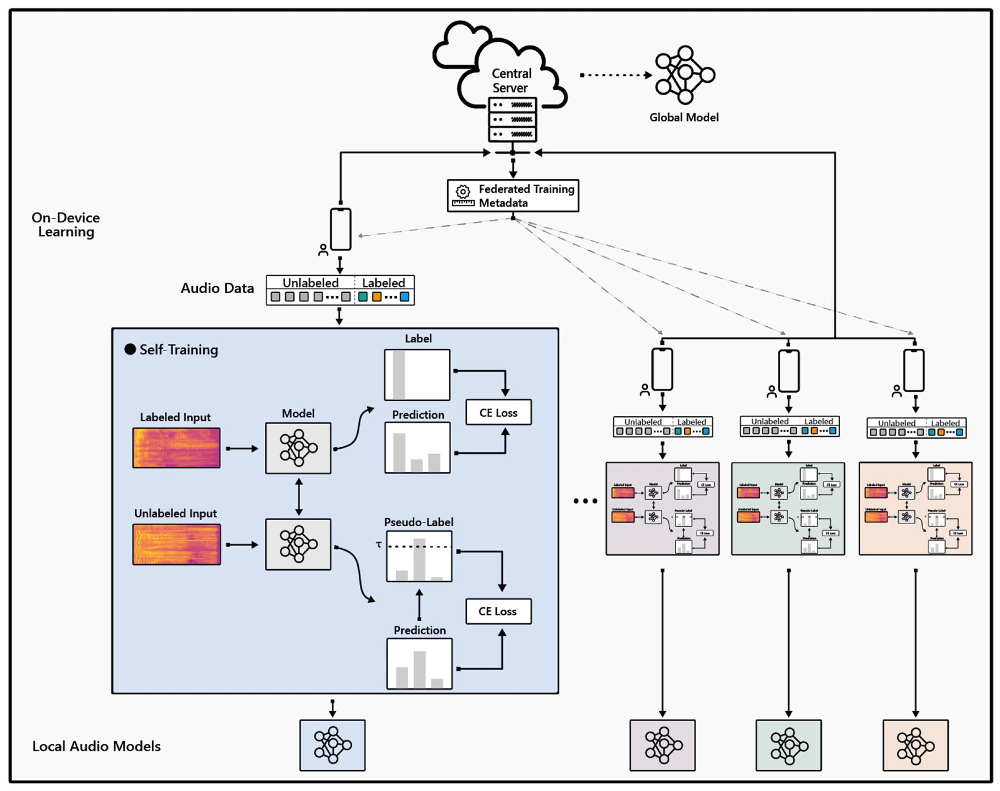

# FedSTAR

**Federated Self-training for Semi-supervised Audio Recognition**

Vasileios Tsouvalas · Aaqib Saeed · Tanir Ozcelebi · ACM TECS 2022

[ Paper](https://doi.org/10.1145/3520128) · [ Project](https://nousphera.github.io/FedSTAR/) · [Poster](https://nousphera.github.io/FedSTAR/poster.pdf)

<p align="center">
  <a href="https://nousphera.github.io/FedSTAR/#overview"></a>
</p>
<p align="center"><sub>Figure 1 · ACM TECS article, p. 74:3. <a href="https://pure.tue.nl/ws/portalfiles/portal/232168240/3520128.pdf#page=4">Original figure</a> · <a href="https://nousphera.github.io/FedSTAR/#overview">Animated method overview</a></sub></p>

## Abstract

Federated Learning is a distributed machine learning paradigm dealing with decentralized and personal datasets. Since data reside on devices such as smartphones and virtual assistants, labeling is entrusted to the clients or labels are extracted in an automated way. Specifically, in the case of audio data, acquiring semantic annotations can be prohibitively expensive and time-consuming. As a result, an abundance of audio data remains unlabeled and unexploited on users’ devices. Most existing federated learning approaches focus on supervised learning without harnessing the unlabeled data. In this work, we study the problem of semi-supervised learning of audio models via self-training in conjunction with federated learning. We propose FedSTAR to exploit large-scale on-device unlabeled data to improve the generalization of audio recognition models. We further demonstrate that self-supervised pre-trained models can accelerate the training of on-device models, significantly improving convergence within fewer training rounds. We conduct experiments on diverse public audio classification datasets and investigate the performance of our models under varying percentages of labeled and unlabeled data. Notably, we show that with as little as 3% labeled data available, FedSTAR on average can improve the recognition rate by 13.28% compared to the fully supervised federated model.

## Requirements and installation

Use Python 3.11 or 3.12 in a dedicated virtual environment.
Create the environment at a path without spaces for Flower/Ray workers.

```bash
git clone https://github.com/Nousphera/FedSTAR.git
cd FedSTAR
bash scripts/setup_env.sh "$HOME/.venvs/fedstar"
source "$HOME/.venvs/fedstar/bin/activate"
python -m pytest -q
```

The script creates a new environment, installs `requirements.txt` including Flower simulation
and tests, and checks dependencies. It never changes an
existing environment. The package and command-line entry points are in `fedstar/`.

## Data preparation

Speech Commands v2 can be downloaded from the official TensorFlow archive. The
command downloads roughly 2.5 GB and needs additional extraction space:

```bash
python scripts/prepare_data.py download-speech --output datasets/speech_commands
python scripts/prepare_data.py speech-commands \
  --train-root datasets/speech_commands/train --test-root datasets/speech_commands/test \
  --output data/speech_commands --seed 2021
python scripts/prepare_data.py validate --manifest data/speech_commands/manifest.json
```

If already downloaded, start with `speech-commands`. This recipe excludes official
validation/test utterances from training and creates 668 seeded one-second
background-noise clips. It records all sample hashes, the split recipe and crop
offsets. [Dataset preparation](data_splits/README.md) also covers importing the
supplied split lists when their complete audio files are available.

[VoxForge and Ambient Context import commands](data_splits/README.md) use supplied
split files and locally acquired audio. All three adapters check split ownership,
decode every recording, and write one shared class mapping with content hashes.
They convert audio to mono and 16 kHz during loading. Preparation never overwrites
existing output. See `python scripts/prepare_data.py --help` for every entry point.

## Training

Run the native Flower ClientApp/ServerApp. The smoke uses two clients, two rounds
and generated waveforms with the full four-block CNN:

```bash
export FLWR_HOME="$HOME/.cache/fedstar-flower"
export FLWR_LOCAL_SUPERLINK_HTTP_API_PORT=39132
export FLWR_LOCAL_CONTROL_API_PORT=39232
export FLWR_DISABLE_RUNTIME_DEPENDENCY_INSTALLATION=1
flwr run . --stream \
  --run-config "config='$(pwd)/configs/smoke.json' output='$(pwd)/runs/flower-smoke'" \
  --federation-config 'num-supernodes=2 client-resources-num-cpus=1 init-args-num-cpus=2'
```

After preparing Speech Commands, use its five-client configuration:

```bash
flwr run . --stream \
  --run-config "config='$(pwd)/configs/speech_commands.json' output='$(pwd)/runs/speech-commands-flower'" \
  --federation-config 'num-supernodes=5 client-resources-num-cpus=1 init-args-num-cpus=2'
```

For the other datasets, substitute `configs/voxforge.json` or
`configs/ambient_context.json`. Match `num-supernodes` to `clients` in the config.
Sequential debugging uses `fedstar train --config configs/smoke.json --output runs/sequential-smoke`.
See [Flower lifecycle and path rules](docs/METHOD.md#native-flower-cli).

## Evaluation

Training evaluates the global model on held-out audio after every round and
writes `accuracy` and `eval_loss` to `metrics.json`. Accuracy is stored as a
fraction. Inspect the final round from the Speech Commands run above:

```bash
python - runs/speech-commands-flower/metrics.json <<'PY_METRICS'
import json
import sys
from pathlib import Path

last = json.loads(Path(sys.argv[1]).read_text())["rounds"][-1]
print(f"Round {last['round']}: accuracy {100 * last['accuracy']:.2f}%, loss {last['eval_loss']:.4f}")
PY_METRICS
```

The supplied dataset configs start with **5 clients and 5% labels**, 100 rounds,
80% participation and one local epoch. To select the published setting below,
set `clients: 15` and `labeled_fraction: 0.03`, then use `num-supernodes=15`
for Flower. Run each setting with three recorded seeds and distinct output
directories. Set `supervised_only: true` for the baseline with matching labeled
clips. See the [experiment guide](docs/METHOD.md#data-and-seeds).

## Pretraining

Optional contrastive pretraining uses separately acquired
[FSD50K development audio](https://zenodo.org/records/4060432):

```bash
python scripts/prepare_data.py prepare-pretraining --root /path/to/FSD50K.dev_audio \
  --output data/fsd50k-clips.json
fedstar pretrain --clips data/fsd50k-clips.json --output runs/pretrain
```

Set `pretrained_encoder` in the downstream config to the resulting
`runs/pretrain/encoder.keras`. Pretraining uses symmetric cross-view InfoNCE
with learned bilinear similarities. The default 500 epochs and batch size 1024
require substantial resources; use `--epochs 1 --batch-size 2` for a short run.
See [the pretraining settings](docs/METHOD.md#contrastive-pretraining).

## Results

**Published three-dataset experiment — 15 clients, 3% labels.** FedSTAR and
supervised FL receive the same labeled clips; FedSTAR also uses the remaining
unlabeled pool. Training uses 100 rounds, one local epoch, 80% participation and
25% data-quantity variation. Mean test accuracy (%) over three runs is shown;
higher is better. [Paper, Table 4](https://pure.tue.nl/ws/portalfiles/portal/232168240/3520128.pdf#page=16).

| Dataset | Supervised FL | FedSTAR |
|---|---:|---:|
| Ambient Context | 33.03 | **49.54** |
| Speech Commands | 62.98 | **86.82** |
| VoxForge | 54.26 | **55.82** |

Run variation is reported in [Appendix Table 9](https://pure.tue.nl/ws/portalfiles/portal/232168240/3520128.pdf#page=25).
The three rows are separate audio classification tasks.
[Explore further published results](https://nousphera.github.io/FedSTAR/#findings).

## Configuration and outputs

Each new run saves resolved configuration, disjoint client partitions and label
masks, environment and input-manifest hashes, round/client metrics, and
`model.keras`. Choose a fresh output directory for every seed and configuration.
The defaults implement `Ls + 0.5 Lu`, temperature 4, and the paper's global-round
confidence schedule. The [method and configuration guide](docs/METHOD.md) covers
sampling, repeated runs, encoder transfer and Flower runtime management.

## Citation

```bibtex
@article{tsouvalas2022fedstar,
  author = {Tsouvalas, Vasileios and Saeed, Aaqib and Ozcelebi, Tanir},
  title = {Federated Self-training for Semi-supervised Audio Recognition},
  journal = {ACM Transactions on Embedded Computing Systems},
  year = {2022},
  volume = {21},
  number = {6},
  articleno = {74},
  numpages = {26},
  doi = {10.1145/3520128},
  url = {https://doi.org/10.1145/3520128}
}
```

## License

Code: [Apache-2.0](LICENSE). Dataset, publication and external-model licenses remain with their providers.
