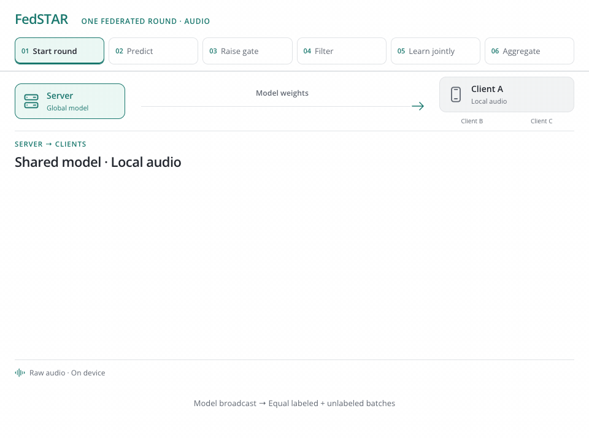

<h1 align="center">FedSTAR</h1>
<p align="center"><strong>Federated Self-training for Semi-supervised Audio Recognition</strong></p>
<p align="center"><a href="https://vtsouval.github.io/"><strong>Vasileios Tsouvalas</strong></a> · Aaqib Saeed · Tanir Özçelebi</p>

<p align="center">
  <a href="https://doi.org/10.1145/3520128" title="Read the paper"></a>
  <picture></picture>
  <a href="https://nousphera.github.io/FedSTAR/" title="Explore the project"></a>
  <picture></picture>
  <a href="https://nousphera.github.io/assets/posters/fedstar-a0-landscape.pdf" title="View the poster"></a>
</p>

## Abstract

**FedSTAR** combines *self-training* with **Federated Learning (FL)** to learn audio recognition models from **few labeled recordings** and abundant *on-device unlabeled audio*. Each client jointly learns from its labels and **confidence-filtered pseudo-labels**, while the server combines local models through *sample-weighted aggregation*. A **progressively increasing confidence threshold** controls which predictions become training targets. Optional *self-supervised audio pretraining* accelerates convergence. Experiments cover **speech commands, ambient sounds and spoken languages** under varying label budgets and client distributions.

<p align="center">
  <a href="docs/assets/readme/method-light.mp4" title="Watch the method video">
    <picture>
      <source media="(max-width: 600px) and (prefers-color-scheme: dark)" srcset="docs/assets/readme/method-dark-mobile.gif">
      <source media="(max-width: 600px)" srcset="docs/assets/readme/method-light-mobile.gif">
      <source media="(prefers-color-scheme: dark)" srcset="docs/assets/readme/method-dark.gif">
      
    </picture>
  </a>
</p>

## Setup

Create and activate the `fedstar` environment:

```bash
git clone https://github.com/Nousphera/FedSTAR.git
cd FedSTAR
python3.12 -m venv --prompt fedstar "$HOME/.venvs/fedstar"
source "$HOME/.venvs/fedstar/bin/activate"
```

From the activated `fedstar` environment, install the requirements:

```bash
python -m pip install -r requirements.txt
```

## Data and Weights

Download, prepare and validate the datasets:

```bash
# One dataset
python scripts/prepare_data.py --dataset speech_commands

# All three recognition datasets
python scripts/prepare_data.py
```

| Dataset | Key | Classes |
| :--- | :--- | ---: |
| [Speech Commands v2](https://www.tensorflow.org/datasets/catalog/speech_commands) | `speech_commands` | 12 |
| [Ambient Context](https://www.esense.io/datasets/ambientacousticcontext/index.html) | `ambient_context` | 9 |
| [VoxForge](https://www.voxforge.org/home/Downloads) | `voxforge` | 6 |

> [!NOTE]
> Speech Commands uses the official held-out split; `--protocol supplied` selects the historical lists when their original audio is available. Ambient Context and VoxForge retain the released splits. Ambient Context contains **nine non-speech classes** in those splits.

For an existing or manually downloaded corpus, add `--source-dir PATH`. Speech Commands expects `PATH/train/` and `PATH/test/`; Ambient Context retains its nested clip folders; VoxForge expects `PATH/<language>/Trunk/Audio/Main/16kHz_16bit/<submission>/wav/`.

### Prepare Model

The paper's **four-block CNN** trains from scratch. For optional **FSD50K contrastive pretraining**:

```bash
python scripts/prepare_data.py --dataset fsd50k
python scripts/prepare_model.py
```

> [!NOTE]
> Pretraining uses [FSD50K development audio](https://zenodo.org/records/4060432), **500 epochs** and **batch size 1024**. Continue an interrupted run with `--resume`. For manual downloads, use `--source-dir PATH` containing `FSD50K.dev_audio/` and `FSD50K.ground_truth/dev.csv`.

## Run Experiments

From the repository root, launch your chosen method as a **Flower App**:

```bash
# Shared experiment settings
common=(--dataset speech_commands --nr-clients 15 --rounds 100
        --participation 0.8 --quantity-variation 0.25
        --labeled-fraction 0.03 --unlabeled-fraction 1
        --local-epochs 1 --batch-size 64 --learning-rate 0.001
        --device cuda)

# FedSTAR (ours) · self-training
python scripts/run_experiment.py "${common[@]}" --method fedstar

# FedAvg · the same labeled recordings
python scripts/run_experiment.py "${common[@]}" --method fedavg

# Fully supervised FL · all labels
python scripts/run_experiment.py "${common[@]}" --method fedavg --labeled-fraction 1

# Centralized · all labels
python scripts/run_experiment.py "${common[@]}" --method centralized --labeled-fraction 1

# FedSTAR with the pretrained encoder
python scripts/run_experiment.py "${common[@]}" --method fedstar \
  --pretrained-encoder checkpoints/fsd50k/encoder.pt
```

> [!NOTE]
> FedSTAR uses equal labeled/unlabeled batches, **temperature 4**, **β = 0.5**, and a cosine confidence threshold from **0.5 to 0.9**. Held-out audio is evaluated each round; final weights and metrics are saved under `results/`.

## Citation

```bibtex
@article{tsouvalas2022fedstar,
  author = {Tsouvalas, Vasileios and Saeed, Aaqib and Ozcelebi, Tanir},
  title = {Federated Self-training for Semi-supervised Audio Recognition},
  journal = {ACM Transactions on Embedded Computing Systems},
  year = {2022},
  volume = {21},
  number = {6},
  articleno = {74},
  numpages = {26},
  doi = {10.1145/3520128},
  url = {https://doi.org/10.1145/3520128}
}
```

[License](LICENSE)
